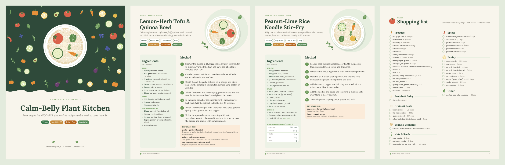

# 🥗 Green Plate

**A Claude plugin for vegetarian and vegan cooking that respects every dietary restriction at once.** It covers low-FODMAP, gluten-free, nut-free, Jain and sattvic diets. A rules engine checks every recipe, and the result is a beautifully illustrated PDF cookbook.



> Sample output: [`examples/calm-belly-week.pdf`](examples/calm-belly-week.pdf) (vegan, low-FODMAP and gluten-free, with a meal plan) and [`examples/jain-paneer-capsicum.pdf`](examples/jain-paneer-capsicum.pdf).

## What you can ask

- *"Give me a vegan, low-FODMAP dinner under 30 minutes."*
- *"Make this recipe Jain and gluten-free"* (with the recipe pasted in).
- *"Plan my week: vegetarian, nut-free, cooking for 2. I want a PDF with a shopping list."*
- *"Is miso low-FODMAP? What can I use instead of garlic?"*
- *"Remember I'm vegan and allergic to sesame."*

## What's inside

| Component | Purpose |
|---|---|
| **Skill `plant-recipes`** | Turns requests into diet-safe recipes: writes JSON, checks it, renders the PDF |
| **Skill `meal-planner`** | Plans a week with batch cooking, leftovers and a combined shopping list |
| **Skill `diet-rules`** | Reference for 7 diets: exclusions, hidden sources, portion limits, swaps, how diets combine |
| **Skill `diet-profile`** | Saves your diets, allergies, dislikes, household size and cuisines |
| **Hook `SessionStart`** | Loads your profile into every session |
| **Hook `PostToolUse` (Write/Edit)** | Re-checks any recipe JSON as soon as it is saved and reports problems back to Claude |
| **Hook `PreToolUse` (Bash)** | Blocks a PDF render whose recipes break their declared diets |
| `scripts/check_recipe.py` | Rules engine (whole-word matching, safe phrases such as "garlic-infused oil", portion warnings, allergies) |
| `scripts/render_pdf.py` | ReportLab PDF cookbook with hand-coded vector vegetable illustrations |
| `scripts/shopping_list.py` | Merges quantities across recipes (1 cup + ½ cup → 1 ½ cup), sorted by aisle |
| `scripts/profile.py` | Reads and writes `~/.green-plate/profile.json` |
| `scripts/diets.json` | The diet rules as data, so you can add terms or whole new diets |

### Supported diets

`vegetarian` · `vegan` (includes vegetarian) · `low-fodmap` · `gluten-free` · `nut-free` · `jain` (includes vegetarian) · `sattvic` (includes vegetarian)

Diets combine. A recipe tagged `["vegan", "low-fodmap", "gluten-free"]` must pass all four rule sets, since vegan includes vegetarian.

## Install

**Claude Code / Cowork (plugin marketplace)**

```
/plugin marketplace add agstya/green_plate
/plugin install green-plate@green-plate-marketplace
```

**Requirements:** Python 3.8+ and ReportLab (`pip install -r requirements.txt`). The checker, hooks and shopping list use only the standard library.

## Use the scripts directly

```bash
# check a recipe or cookbook against the diets it declares (plus your profile's allergies)
python3 scripts/check_recipe.py examples/calm-belly-week.json

# check a single ingredient
python3 scripts/check_recipe.py --ingredient "asafoetida" --diets gluten-free,jain

# render the PDF (--paper white for printing, --size a4)
python3 scripts/render_pdf.py examples/calm-belly-week.json -o cookbook.pdf

# shopping list as markdown
python3 scripts/shopping_list.py examples/calm-belly-week.json

# save your profile
python3 scripts/profile.py set --name "Sam" --diets vegan,low-fodmap --allergies sesame --household 2
```

The recipe JSON format is documented in [`skills/plant-recipes/references/recipe-schema.md`](skills/plant-recipes/references/recipe-schema.md).

## The PDF

- **Cover:** a deep-green panel of scattered vegetables around an illustrated bowl, with the title and diet badges.
- **Contents:** recipe titles with page numbers, timings and diet tags.
- **Recipe pages:** a hero bowl drawn from the recipe's own ingredients (tomato, carrot, tofu, lime, chili and 13 more icons), meta chips, and a sage ingredients panel with nutrition, portion notes and cook's notes. Numbered method steps are followed by a "Diet swaps used" box.
- **Weekly meal plan table** with prep-ahead tips.
- **Two-column shopping list** with checkboxes, sorted by aisle.
- **Diet guide and notes.**

To use your own photo, add `"image": "photos/curry.jpg"` to a recipe; it is cropped into the hero circle.

## Tests

```bash
pip install pytest reportlab
python3 -m pytest -q
```

## Disclaimer

Green Plate is a cooking aid, not medical advice. Low-FODMAP serving sizes follow Monash University guidance; check the Monash FODMAP app for current values, and follow an elimination diet with a dietitian. Always read labels for allergens and gluten.

## License

Code: MIT. Bundled fonts (Plate Serif, a renamed static build of Lora, and Poppins): SIL Open Font License 1.1. See [`assets/fonts/OFL.txt`](assets/fonts/OFL.txt).
